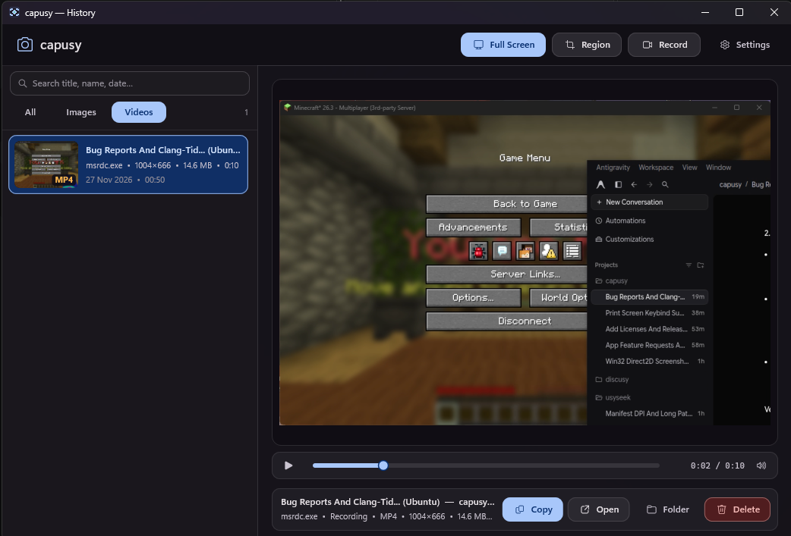

<h1 align="center">capusy</h1>
<h3 align="center">Lightweight Native Screenshot & Region Recording Utility for Windows</h3>

> [!IMPORTANT]
> **Notice: This entire application, architecture, and codebase is 100% AI-generated.**

- **100% Local & Privacy-First**: All capturing, encoding, history indexing, and playback run locally. Zero telemetry, zero analytics, zero cloud dependencies.
- **Single Native Executable**: Built with **C++23**, **Win32**, **Direct2D 1.3**, and **Media Foundation**—no Electron, no .NET runtime, and no external `ffmpeg` binary required.
- **Found a bug or have a suggestion?** Feel free to open an issue or reach out to `@usy_` on Discord!
- **Contributions are welcome**: PRs and improvements will always be considered!

---

## Overview

**capusy** is a fast, Per-Monitor DPI-aware screenshot and region screen recording tool for Windows 10/11 built with **C++23**, **Win32**, **Direct2D 1.3**, **DirectWrite**, and **Windows Media Foundation**.

Designed to stay tiny in the system tray, `capusy` registers global hotkeys directly for zero-latency freeze-frame captures and unthrottled rapid-fire screenshots, while automatically releasing GPU and UI resources whenever all windows are hidden.

---

## Features

### 🖼️ History & Media Preview

<p align="center">
  
</p>

- **SQLite-Backed History**: Automatically tracks every screenshot and recording with window title, process name, resolution, file size, duration, and timestamp.
- **Instant Search & Filtering**: Search captures by title, filename, or date, and filter between **All**, **Images**, or **Videos**.
- **Built-In Media Player**: Preview images and play back recorded MP4 videos directly inside the history window with seek controls, volume adjustment, and mute support.
- **One-Click Actions**: Copy to clipboard, open in the default viewer, reveal in Explorer, or delete directly from the preview bar.

### 📸 Screenshot Capture & Annotations
- **Full-Screen & Region Capture**: Capture all monitors immediately or freeze every display for pixel-accurate region selection with window and UI element snapping.
- **Instant or Edit Mode**: Choose between instant capture on click/release or an interactive annotation overlay with **Pen**, **Highlighter**, **Rectangle**, **Ellipse**, **Line**, and **Arrow** vector tools.
- **Flexible Output Formats**: Save captures as **PNG**, **JPEG** (configurable quality), **BMP**, or **TIFF**, with optional automatic clipboard copy and cursor capture.
- **ShareX-Compatible Folder Layout**: Optionally organize saved files into `YYYY-MM` monthly subdirectories.
- **Corner Preview Toast**: Configurable non-intrusive thumbnail notification on the primary monitor after each capture.

### 🎬 Region Screen Recording
- **Native Hardware-Accelerated MP4**: Records selected screen regions directly to **H.264 + AAC MP4** using Windows Media Foundation—no external encoder downloads needed.
- **Configurable Quality**: Choose between **30 FPS** or **60 FPS**, adjustable bitrate (default 12 Mbps), and optional cursor recording.
- **Desktop & Microphone Audio**: Capture system loopback audio and/or microphone input with selectable audio devices.

### ⚙️ Hotkeys, Settings & System Tray
- **Interactive Global Hotkey Recorder**: Rebind any shortcut or disable it entirely. Supports standalone keys like `PrintScreen` and `F1–F24`, including a low-level hook fallback when Windows holds `VK_SNAPSHOT`.
- **Lean Idle Footprint**: Drops the Direct3D/Direct2D device when idle and recreates it on demand for minimal memory and GPU usage in the background.
- **Windows Startup & Auto-Updater**: Optional launch-at-login toggle and built-in update checker.

---

## Shortcuts & Controls

| Shortcut / Action | Function |
| :--- | :--- |
| <kbd>Alt</kbd> + <kbd>Shift</kbd> + <kbd>1</kbd> | Full-Screen Screenshot (customizable in Settings) |
| <kbd>Alt</kbd> + <kbd>Shift</kbd> + <kbd>2</kbd> | Region Screenshot (customizable in Settings) |
| <kbd>Alt</kbd> + <kbd>Shift</kbd> + <kbd>3</kbd> | Region Recording — Start / Stop (customizable in Settings) |
| <kbd>Alt</kbd> + <kbd>Shift</kbd> + <kbd>H</kbd> | Open Screenshot & Recording History (customizable in Settings) |
| <kbd>Esc</kbd> | Cancel active region selection or close overlay |
| **Right-Click Tray Icon** | Open Win32 context menu (Full Screen, Region, Record, History, Settings, Check for Updates, Quit) |

---

## System Requirements

- **Operating System**: Windows 10 (version 1809+) or Windows 11 x64
- **C++ Compiler**: MSVC from Visual Studio 2022 (v143+) supporting C++23 (`/std:c++latest`)
- **CMake**: `3.31+`
- **Build System**: [Ninja](https://github.com/ninja-build/ninja)

---

## Building from Source

### 1. Environment Setup

Ensure MSVC, CMake, and Ninja are available in your `PATH`. If you use portable development environments, you can run `build.bat` or load your environment scripts first.

### 2. CMake Build

Configure and build using CMake directly:

```cmd
cmake -S . -B build -G Ninja ^
    -DCMAKE_BUILD_TYPE=Release ^
    -DCMAKE_C_COMPILER=cl ^
    -DCMAKE_CXX_COMPILER=cl ^
    -DCMAKE_EXPORT_COMPILE_COMMANDS=ON

cmake --build build --parallel
```

### 3. Build Output Layout

The compiled executable is placed in `build/bin/`:

```
build/bin/
└── capusy.exe               # Self-contained screenshot & recording utility
```

---

## CMake Configuration Flags

| Option | Default | Description |
| :--- | :--- | :--- |
| `CAPUSY_USE_MIMALLOC` | `ON` | Replace the default allocator with Microsoft `mimalloc` |
| `CAPUSY_USE_INTERPROCEDURAL_OPTIMIZATION` | `ON` | Enable Link-Time Optimization (LTO/LTCG) |
| `CAPUSY_USE_STATIC_MSVCRT` | `ON` | Link against static MSVC runtime (`/MT`) |
| `CAPUSY_USYLIBPP_VERSION` | `main` | Git branch/tag for `usylibpp` |
| `CAPUSY_GLAZE_VERSION` | `v9.1.0` | Git tag for `glaze` (high-performance JSON) |
| `CAPUSY_MIMALLOC_VERSION` | `v3.7.1` | Git tag for `mimalloc` |
| `CAPUSY_SQLITE_VERSION` | `3540100` | SQLite amalgamation release |

---

## Getting Help & Community

- **Found a bug?** Open an issue on GitHub.
- **Questions or ideas?** Reach out to `@usy_` on Discord.
- Pull requests and contributions are always welcome!
